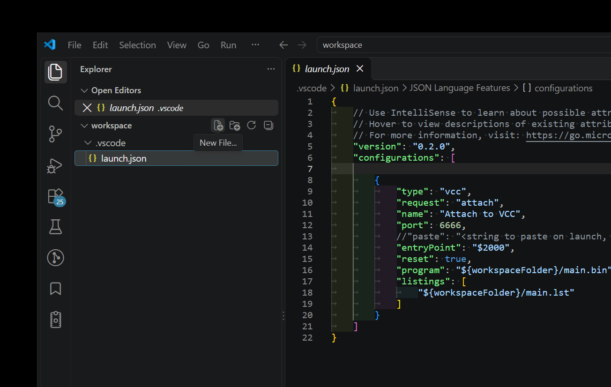
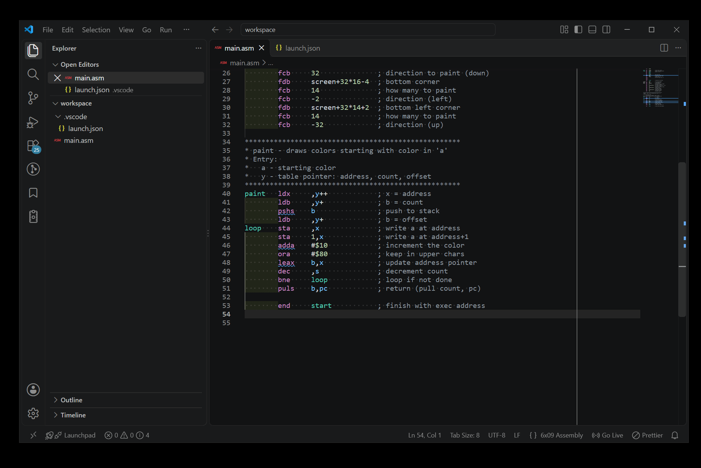
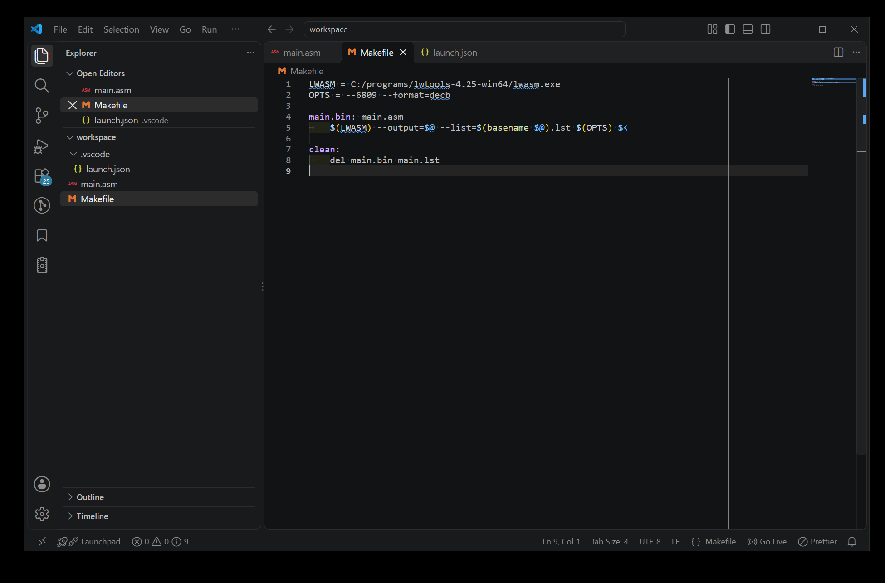
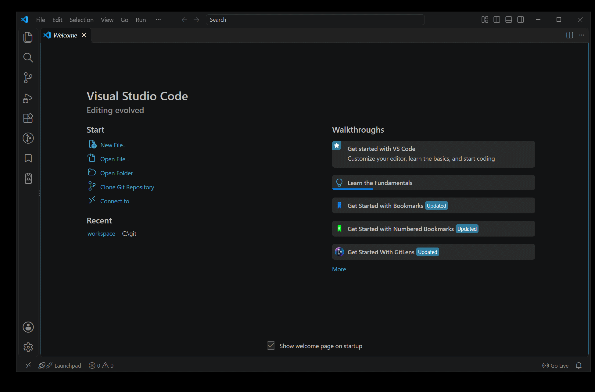
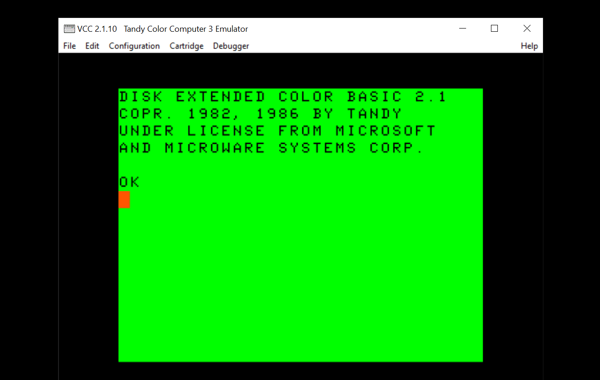
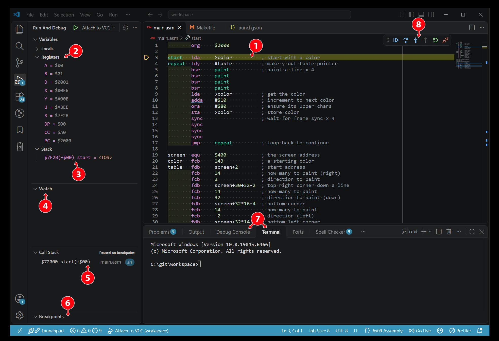
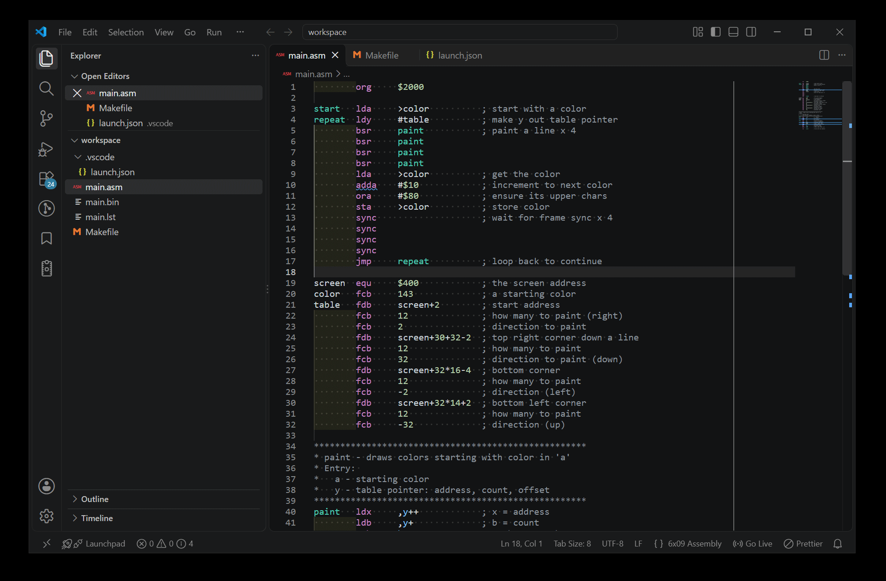
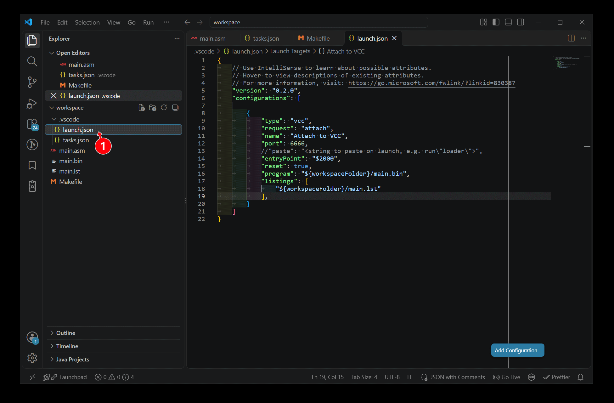

# Example

The following is a short example of debugging assembly with Visual Studio Code and VCC. It assumes you've already followed the steps in [Installation](#installation) to set up your environment.

#### Contents

- [1. Create main.asm](#1-create-mainasm)
- [2. Write some code](#2-write-some-code)
- [3. Make](#3-make)
- [4. Build](#4-build)
- [5. Build, continued](#5-build-continued)
- [6. Activate Debug Server](#6-activate-debug-server)
- [7. Debugging](#7-debugging)
- [8. Automate Building](#8-automate-building)


Open Visual Studio Code and the 'workspace' folder.

### 1. Create main.asm

Create a top-level assembly file.

1. Click the File Explorer at the top left. This will show the File Explorer, a panel which from top to bottom shows the currently opened files, a tree view of the workspace, and near the bottom (not seen in the picture) the current file's Outline and Timeline.
2. Create a main.asm file by clicking on the 'New File' icon, usually after choosing which folder you want it in.
3. Type in the name main.asm and press ENTER. You'll notice in the open editors above that it will show '.vscode' next to main.asm, indicating that the file is currently in this folder. As we don't yet have any other folders, it happens to create it in the .vscode folder, which is a little odd, but never mind — we'll move it.
4. To move it to the workspace root, drag the file to the blank space below it.
5. It will ask if you wish to move it to 'workspace', so agree by pressing the 'Move' button.

Now we're ready to begin coding.



---

### 2. Write some code

Write your own code if you wish but otherwise here is a small program to try. Just copy and paste it into your main.asm file.

It loads at $2000, takes a color (text character) and calls 'paint' function 4 times for the 4 entries in a table that define how. Increments the color and loops.

```asm
        org     $2000

start   lda     >color          ; start with a color
repeat  ldy     #table          ; make y out table pointer
        bsr     paint           ; paint a line x 4
        bsr     paint
        bsr     paint
        bsr     paint
        lda     >color          ; get the color
        adda    #$10            ; increment to next color
        ora     #$80            ; ensure its upper chars
        sta     >color          ; store color
        sync                    ; wait for frame sync x 4
        sync
        sync
        sync
        jmp     repeat          ; loop back to continue

screen  equ     $400            ; the screen address
color   fcb     143             ; a starting color
table   fdb     screen+2        ; start address
        fcb     14              ; how many to paint (right)
        fcb     2               ; direction to paint
        fdb     screen+30+32-2  ; top right corner down a line
        fcb     14              ; how many to paint
        fcb     32              ; direction to paint (down)
        fdb     screen+32*16-4  ; bottom corner
        fcb     14              ; how many to paint
        fcb     -2              ; direction (left)
        fdb     screen+32*14+2  ; bottom left corner
        fcb     14              ; how many to paint
        fcb     -32             ; direction (up)

****************************************************
* paint - draws colors starting with color in 'a'
* Entry: 
*   a - starting color
*   y - table pointer: address, count, offset
****************************************************
paint   ldx     ,y++            ; x = address
        ldb     ,y+             ; b = count
        pshs    b               ; push to stack
        ldb     ,y+             ; b = offset
loop    sta     ,x              ; write a at address
        sta     1,x             ; write a at address+1
        adda    #$10            ; increment the color
        ora     #$80            ; keep in upper chars
        leax    b,x             ; update address pointer
        dec     ,s              ; decrement count
        bne     loop            ; loop if not done
        puls    b,pc            ; return (pull count, pc)

        end     start           ; finish with exec address

```

Refer to the 6809 [Assembly Instruction Reference](https://colorcomputerarchive.com/repo/Documents/Books/Motorola%206809%20and%20Hitachi%206309%20Programming%20Reference%20(Darren%20Atkinson).pdf) for description of the individual instructions.

### 3. Make

To build our project, we can use the 'make' utility.

1. Click on 'New File' from the Explorer panel.
2. Type in 'Makefile' for the filename. (A capital letter is the standard.)
3. Press ENTER and you can cut and paste the following:

	```
	LWASM = C:/programs/lwtools-4.25-win64/lwasm.exe
	OPTS = --6809 --format=decb

	main.bin: main.asm
		$(LWASM) --output=$@ --list=$(basename $@).lst $(OPTS) $<

	clean:
		del main.bin main.lst
	```

This is pretty straightforward. The first two lines just define some values we'll use on the lines below them. My lwtools is at `c:\programs\lwtools-4.25-win64\` so replace this path with yours.

The next section tells make to build `main.bin` whenever its dependent, i.e. `main.asm` (there could be multiple), is changed, by running the shell commands (indented) under this rule. A variable such as LWASM will be expanded to the value we previously set. The `$@` represents the target (main.bin) and `$<` represents the first dependent.

The next section tells make that when we run `make clean`, it should run these shell commands (indented). In this case, it just removes the two files created by the previous section.

That's it, simple.

Note: Indentation is important in a Makefile; the shell commands are indented by one tab.



---

### 4. Build

Now that we have our Makefile, we can manually run it to build the project.

1. Open a new Terminal window.
2. Type `make`. It may fail if you don't have make installed.
3. If so, use winget to install it: type `winget install ezwinports.make`.
4. Once make is successfully installed, close Visual Studio Code and reopen it so that it picks up the updated path to make.



---

### 5. Build, continued

After restarting Visual Studio Code:

1. Click on the recent project — 'workspace' in our case — to continue the project.
2. A Terminal window should already be open, but if not, open a new one from the menu, then type `make` to build our project.
3. If successful, you should end up with two extra files: `main.bin` and `main.lst`.

These are the filenames we added to launch.json in the [Installation](#7-customize-launchjson) steps 6 & 7.



### 6. Activate Debug Server

Launch VCC and enable the debug server:

1. Click on the 'Debugger' menu.
2. Select 'Debug Server' to enable it.

A tick will appear next to it when it's enabled.



### 7. Debugging

Now we're ready to begin debugging. Press `F5` to launch the program in VCC; Visual Studio Code will switch to the debugging tab and stop with the cursor on the first instruction at $2000, as seen below.

The following are the various components of the debugging session:

1. Currently paused on a breakpoint — the highlighted line showing where the CPU is currently stopped. Here it's stopped at the entry point we specified in launch.json.
2. The CPU registers and their values.
3. The stack contents — this shows bytes that were pushed to the stack along with a return address, which starts with 'r'. The offset is how far from the current stack pointer (SP).
4. The watch window, where expressions are evaluated while stopped.
5. The call stack, showing the address, which function we're in, and the byte offset from the start of that function (the nearest symbol), along with the file and line number. As more functions are called, this will grow to multiple lines; clicking on any of them takes you to the caller.
6. The breakpoints window (collapsed here) will show current locations in the source code where breakpoints are set, clicking on one will jump to that place. 
7. The Debug Console & Terminal windows. The Debug Console allows commands to be issued to the debugger (future). The Terminal window will appear when building to show the output.
8. The debugger controls: Pause-Run (F5), Step Over (F10), Step In (F11), Step Out (Shift+F11), Restart (Ctrl-Shift+F5), Disconnect (Shift+F5).

To continue executing the program, press `F5`.

To stop, just select a line and press `F9` to add a breakpoint.

To end debugging, use `Shift+F5`.

See [keyboard shortcuts](#keyboard-shortcuts) for more shortcuts.



### 8. Automate Building

As it stands, we have to type `make` in the Terminal window when we make changes to the source. It's tedious, so let's automate it. We'll need a `tasks.json` for this.

1. Press `Ctrl-Shift-P` for the Command Palette (a list of commands) and type `tasks` to filter this list for all task-related commands, and find the one called `Tasks: Configure Task` and select it.
2. A list will appear with various options; scroll down to `Create tasks.json from template` and select it.
3. Another shorter list will appear; from this, select `Others: Example to run an arbitrary external command`. This will give us a simple echo test task.
4. Change the 'label' to `Build`.
5. Change the 'command' to `make` and save the file.



Now we need to update the `launch.json` to tell Visual Studio Code what task to run when F5 is pressed.

1. Select the `launch.json` from the `.vscode` directory.
2. Ensure there is a comma after the `]`, and on the next line type a double quote `"` and then `preLaunchTask`. You can press `TAB` to complete the word and a menu will appear.
3. Select the "Build" option, save the file.
4. Click on `main.asm`.
5. Make some changes, such as commenting out the sync lines, and then press F5 to start debugging.
6. You will notice that it ran `make` in the terminal and will stop at the start of the program; you can press F5 to run it.



Now, any changes made will be automatically built before debugging. Good luck!   


<hr>
<p align="center">
  <sub><sup>Written by Craig Allsop · Updated 2026-11-27 · <a href="#">Back to top</a></sup></sub>
</p>

