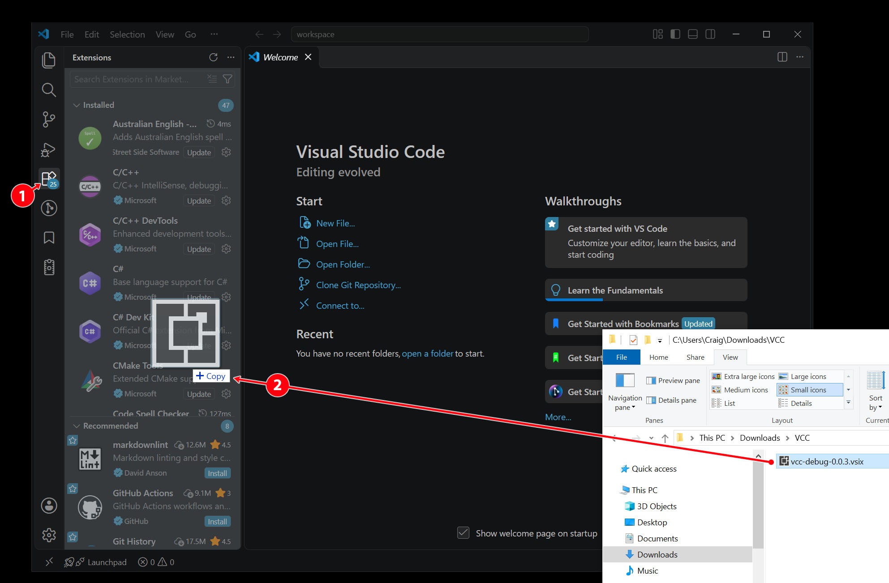
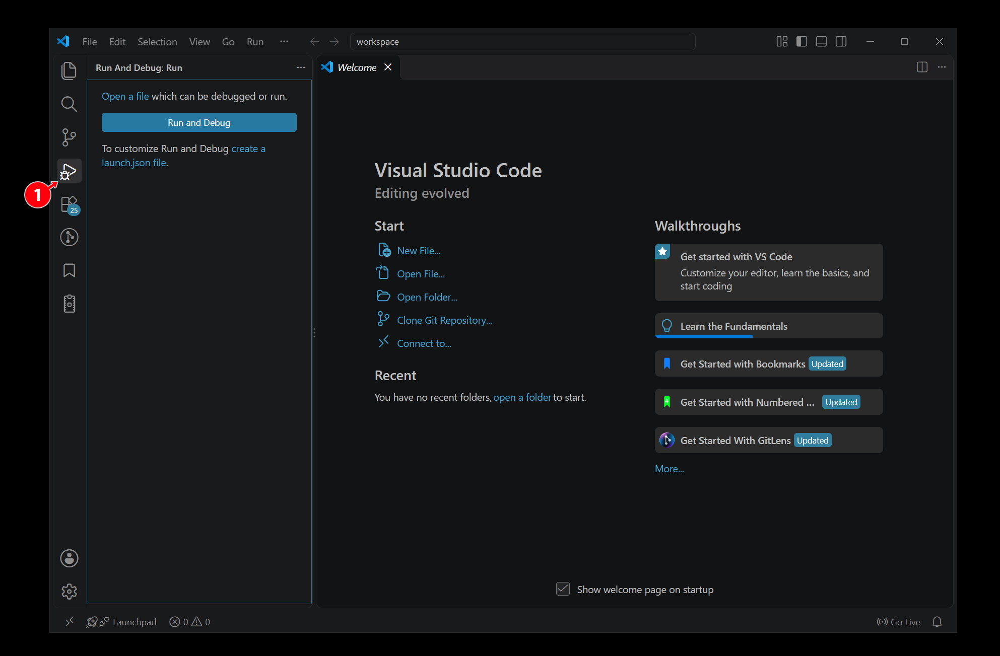
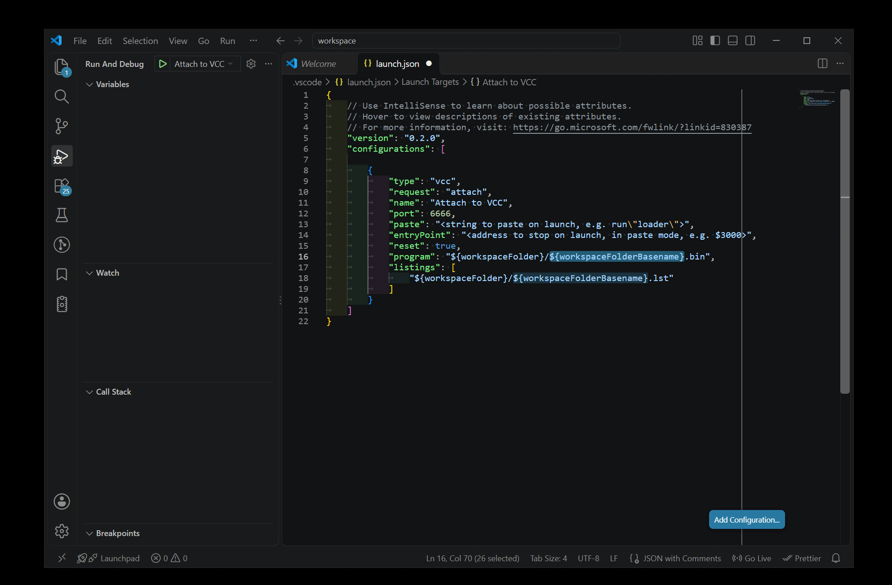

# Installation

## Prerequisites

| Tool | Version | Notes |
|------|---------|-------|
| VCC | 2.1.10+ | Windows — [GitHub releases](https://github.com/VCCE/VCC/releases) |
| Visual Studio Code | 1.147.0+ | Editor — [code.visualstudio.com](http://code.visualstudio.com) |
| VCC Debug Extension Package (.vsix) | 1.0.0.0+ | Extension for Visual Studio Code —<br/> [GitHub vcc-debug](https://github.com/callsop/vcc-debug) |
| Lwtools | 4.25+ | [Lwtools Webpage](https://www.lwtools.ca/)<br/> See 4.25 link has win64 Windows binaries.|


## Setup

To prepare for debugging with Visual Studio Code, follow these steps, or skip a step if already done.

#### Contents

- [1. Install VCC](#1-install-vcc)
- [2. Install Visual Studio Code](#2-install-visual-studio-code)
- [3. Install the Visual Studio Code Extension](#3-install-the-visual-studio-code-extension)
- [4. Open an Assembly Project](#4-open-an-assembly-project)
- [5. Create a launch.json](#5-create-a-launchjson)
- [6. Customize launch.json](#6-customize-launchjson)
- [7. Install Lwtools](#7-install-lwtools)
- [8. Next Step](#8-next-step)

### 1. Install VCC

#### Using Windows Store

This is generally the quickest and easiest option.
1. Launch the Windows Store from the Start menu.
2. Type 'VCC' in the search box to find the app.
3. When you see VCC, click the Install button.

#### Using Zip

This is useful if you have multiple versions, or don't want to use the installer.
1. Download the latest VCC release from the [VCCE/VCC GitHub](https://github.com/VCCE/VCC/releases).
2. Extract to a suitable path, e.g. `C:\vcc-2.1.9.10\`.
3. Place your CoCo 3 ROM in the VCC directory (or configure the path in `vcc.ini`).

---

### 2. Install Visual Studio Code

Download and install Visual Studio Code from [code.visualstudio.com](http://code.visualstudio.com). There is a download link in the top right.

---

### 3. Install the Visual Studio Code Extension

This step is only required once, or when there is a new version of the .vsix package. This will add support to Visual Studio Code for attaching to VCC in a debugging session.

With Visual Studio Code running:
1. Click on the 'Extensions' tab in the panel on the left edge.
2. Drag and drop the .vsix package file onto the Extensions panel, as shown below.



---

### 4. Open an Assembly Project

To open a project with Visual Studio Code, either launch it and choose 'Open Folder...' to pick the directory containing your project.

OR from a shell, run Visual Studio Code from the directory containing your project (e.g. workspace):
```
> cd workspace
> code .
```

---

### 5. Create a launch.json

In order to configure Visual Studio Code for attaching to VCC, a launch.json is required. This contains the instructions relevant to your project. The file is stored in your workspace at `.vscode/launch.json`.

To create it:
1. Click on the 'Debugger' tab in the panel on the left edge.
2. A panel will appear with a blue button and, under it, a link to 'create a launch.json'. Click this link and a menu will appear listing the available debuggers.
3. Choose 'VCC' from the list (this depends on Step 4).



---

### 6. Customize launch.json

Customize the launch.json for your project:
1. Change `${WorkspaceFolderBasename}` to the binary of your top-level assembly file. Also change the listing(s) to your `.lst` file produced by lwasm.
2. Comment out any lines you don't need for now.
3. Set the entry point (start address) of your binary. We'll make it `$2000` for our sample.
4. Save (Ctrl+S) and close this file.

For more complex projects and detailed information about these options, please refer to the [Usage Guide](Usage.md).

   

---

### 7. Install Lwtools

With the downloaded win64 zip, extract the files into a suitable location on your machine. Such as 'C:\programs\lwtools-2.25-win64\`

---

### 8. Next Step

For a beginner friendly example, follow along with the [Example](Example.md).


<hr>
<p align="center">
  <sub><sup>Written by Craig Allsop · Updated 2026-11-27 · <a href="#">Back to top</a></sup></sub>
</p>

