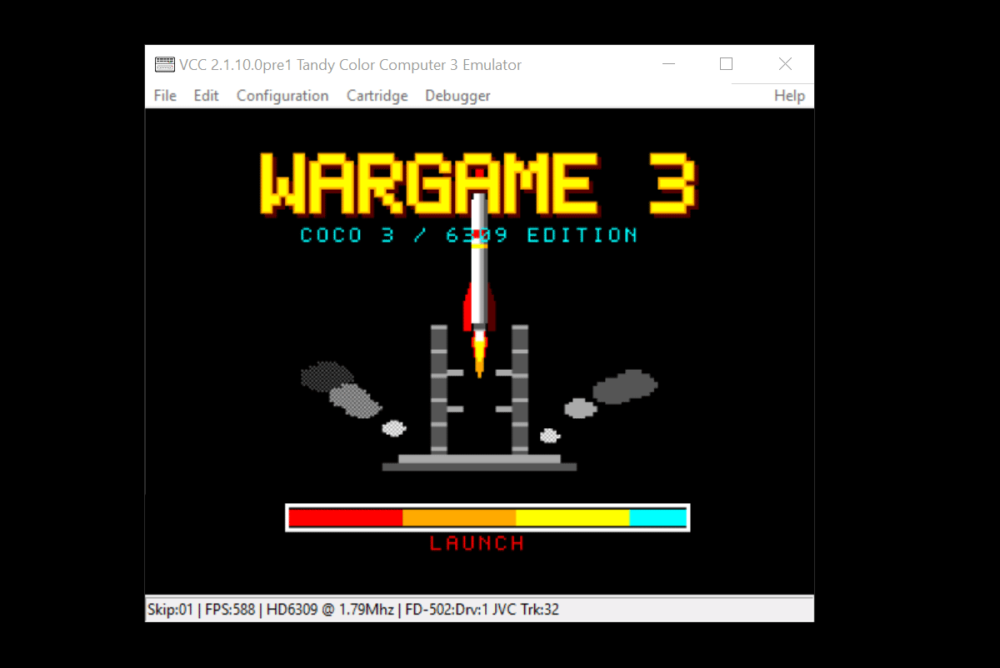
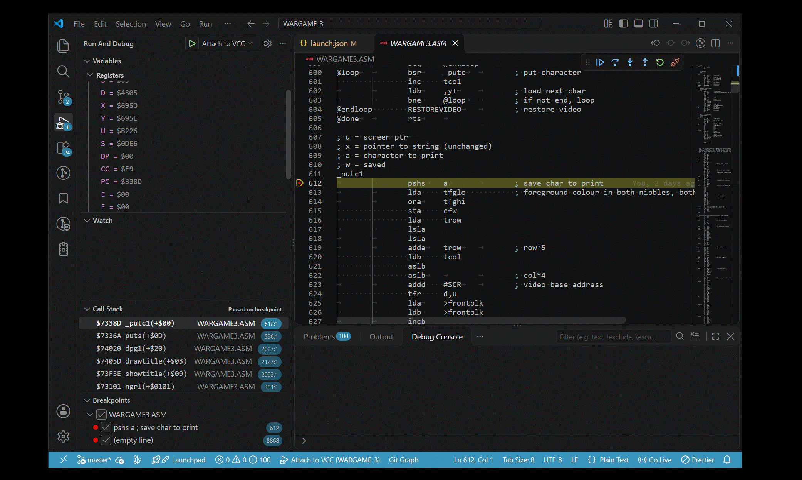
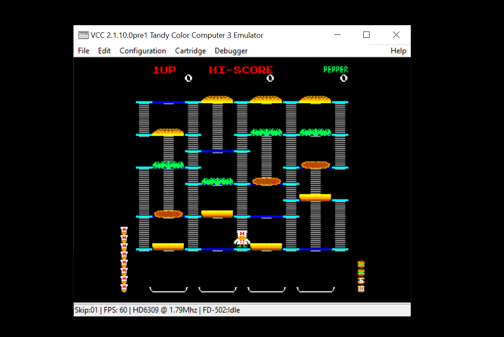
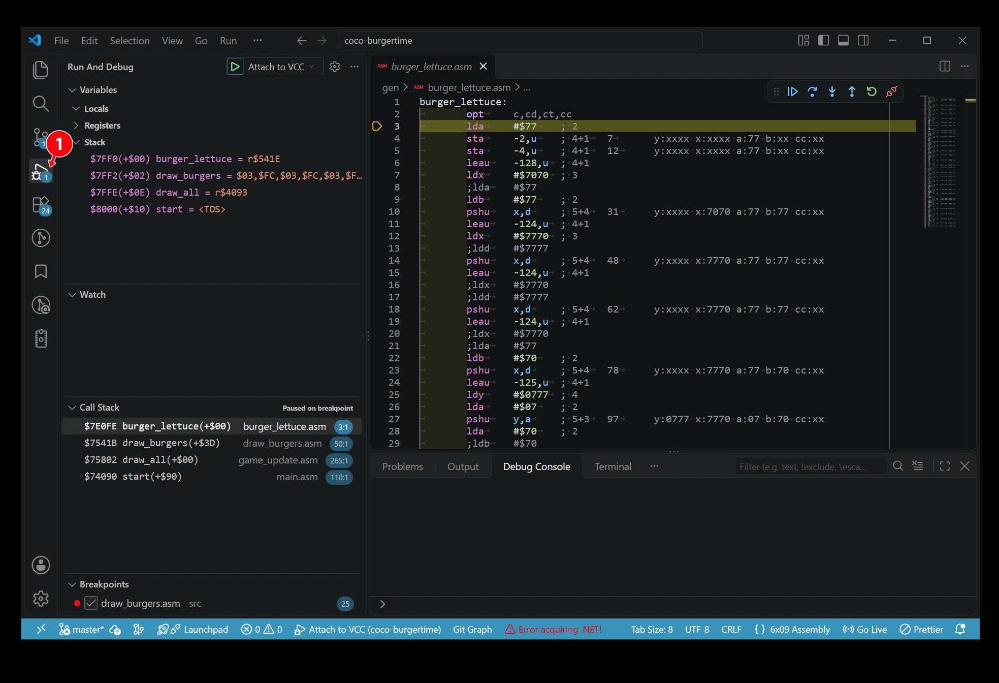

# Projects

#### Contents

- [Wargame 3](#wargame-3)
- [Burger Time](#burger-time)


### Wargame 3

<div align="center">

</div>

In this project, there is just one .asm file, so building is similar to that of the Example. However, there is a lot of data which goes with the game: 3 DSKs. These can be mounted in floppy disks 1, 2, and 3 in VCC, and the game has a config program to allow this scenario.

For debugging this game, the launch.json shall use the 'paste' option to start the game by typing `run"wg"` into DOS. The entry point is $3000.


.vscode/launch.json:
```
{
	// Use IntelliSense to learn about possible attributes.
	// Hover to view descriptions of existing attributes.
	// For more information, visit: https://go.microsoft.com/fwlink/?linkid=830387
	"version": "0.2.0",
	"configurations": [
		{
			"type": "vcc",
			"request": "attach",
			"name": "Attach to VCC",
			"port": 6666,
			"preLaunchTask": "build",
			"reset": true,
			"paste": "run\"wg\n",
			"entryPoint": "$3000",
			"listings": [
				"${workspaceFolder}/WARGAME3.lst"
			]
		}
	]
}
```

For the pre-launch build task, this will be called before debugging starts to ensure it's up to date.

.vscode/tasks.json:

```
{
	"version": "2.0.0",
	"tasks": [
		{
            "label": "build",
            "type": "shell",
            "command": "b.bat",
            "problemMatcher": "$lwasm",
            "group": {
                "kind": "build",
                "isDefault": true
            }
		}
	]
}
```

The b.bat is just a batch file containing the shell commands to call lwasm and produce `WARGAME3.bin` and `WARGAME3.lst`, then copy it onto DSK 2 where the game is stored.

b.bat:
```
c:\Programs\lwtools-4.25-win64\lwasm.exe --6309 --list=WARGAME3.LST --output=WARGAME3.BIN --format=decb WARGAME3.ASM
c:\Programs\toolshed-2.6.0\decb.exe copy -2 -b WARGAME3.BIN -r WARGAME2.DSK,WARGAME3.BIN
```

Here we can see it stopped at a breakpoint in a function called _putc (draws a character). The Call Stack shows the callers of _putc.   


</div>

---

### Burger Time

<div align="center">

</div>

In this project, there are many assembly files. A top-level assembly file includes the sources, so it's a single compile command.

This project uses M4, the macro preprocessor, for macros, and all the assembly files are run through the processor. This results in line numbers being different in the final LWASM listing file; however, M4 can emit source line information with -s. The debugger will use these alternative source line mappings if they are present. This allows breakpoints to be set in the original files.

The assets for this project also generate assembly files, a file for each sprite (a compiled sprite). These also get included by the top-level file, but have no source (the source is the image.png file). Thus, we see below (see 3) that stopping on one of them will show the generated file instead.

For this launch.json, it executes the binary directly as everything for the game is contained within it, including its assets. It modifies the MMU as it loads. I haven't specified the entry point since I didn't want it to stop after loading.  

The launch.json:

```
{
	// Use IntelliSense to learn about possible attributes.
	// Hover to view descriptions of existing attributes.
	// For more information, visit: https://go.microsoft.com/fwlink/?linkid=830387
	"version": "0.2.0",
	"configurations": [
		{
			"type": "vcc",
			"request": "attach",
			"name": "Attach to VCC",
			"port": 6666,
			"reset": true,			
			"program": "${workspaceFolder}/gen/bt.bin",
			"reset": true,
			"listings": [
				"${workspaceFolder}/bt.lst"
			]
		}
	]
}
```

1. The debugger is active and stopped on burger_lettuce compiled sprite.
2. Clicking the Explorer shows the source files view.
3. Here we see that burger_lettuce has come from the generated directory.




<hr>
<p align="center">
  <sub><sup>Written by Craig Allsop · Updated 2026-11-27 · <a href="#">Back to top</a></sup></sub>
</p>

